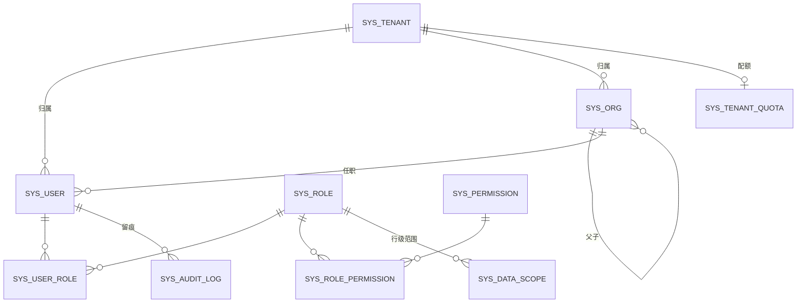
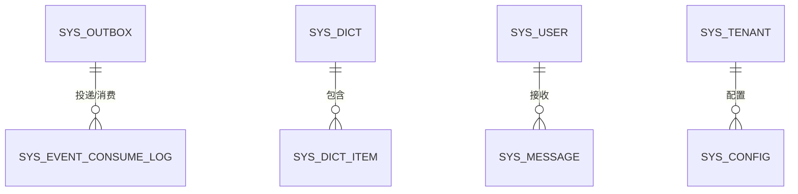
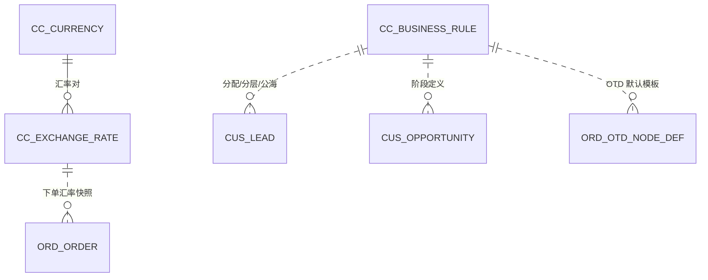
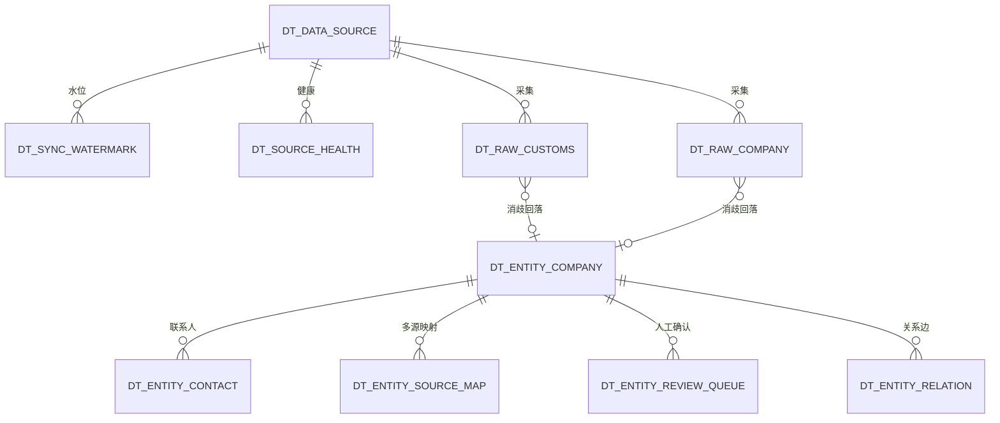
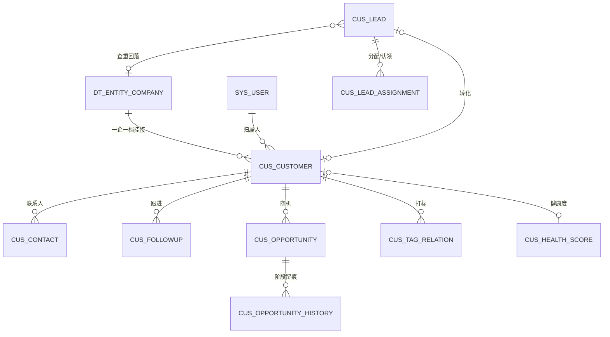
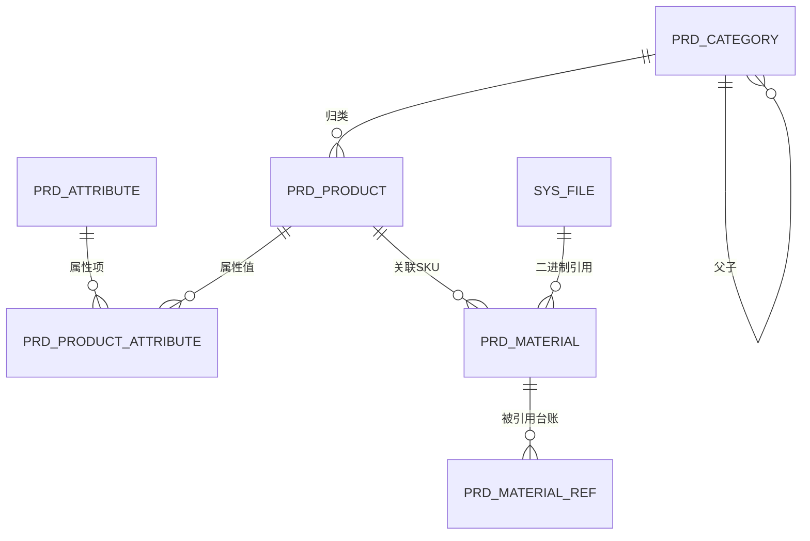
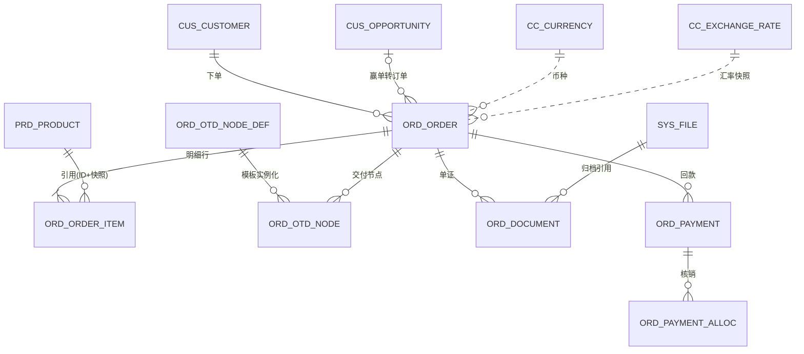

# 灵犀系统概念数据模型 · 实体清单（骨架主干）

> 版本：V0.1 草案（待评审） ｜ 2026-09-11 ｜ 任务：M0000-008
> 配套：[概念数据模型-总览](./概念数据模型-总览.md)（范围/命名/公共约定/事件挂点见总览）
> 说明：本清单到**实体（表）与关系**粒度，不含字段级类型/索引/约束（下一阶段）。

**图例**：`A`=P0-A 骨架批 · `B`=P0-B 增强批（登记不展开） · `机制`=平台公共机制 · `派生`=视图/物化视图/指标，不落事实表 · `红线`=命中即转人工 Review。

---

## 一、L0 平台核心

### 1.1 身份与权限（`sys_`）　`红线`

| 表名 | 中文名 | 职责 | 关键关系 | 功能编号 | 标注 |
|---|---|---|---|---|---|
| `sys_tenant` | 租户 | 多租户主体，Realm↔租户；租户级配置入口 | 1─N 所有业务表（`tenant_id`） | CC-13 底座 | A |
| `sys_tenant_quota` | 租户配额账本 | API/Token/存储/账号/发信量配额 | N─1 `sys_tenant` | 4.1 配额计量 | A `红线` |
| `sys_user` | 用户 | 用户主数据（认证权威在 Keycloak，本表存业务侧摘要/映射） | N─M `sys_role` | CC-13 | A |
| `sys_role` | 角色 | RBAC 角色，对齐五关键角色 | N─M `sys_user`/`sys_permission` | CC-14 | A |
| `sys_user_role` | 用户-角色 | 角色映射 | 关联 | CC-14 | A |
| `sys_permission` | 权限资源 | 功能权限码 `{域}:{对象}:{动作}` 注册 | 1─N `sys_role_permission` | CC-15 | A |
| `sys_role_permission` | 角色-权限 | 权限绑定（或以 `casbin_rule` 承载） | 关联 | CC-15 | A |
| `sys_data_scope` | 数据权限 | 行级范围 SELF/DEPT/DEPT_AND_SUB/CUSTOM/ALL；维度含归属人/部门/区域/市场 | N─1 `sys_role` | CC-16 | A `红线` |
| `sys_org` | 组织/部门树 | 部门与上下级，支撑 DEPT/DEPT_AND_SUB | 自关联 `parent_id`；1─N `sys_user` | CC-16 支撑 | A |
| `sys_audit_log` | 审计日志 | 谁/何时/何地/对什么/做了什么/改前改后；含 `source_type` | 全局；按月分区 | CC-18 | B |



### 1.2 公共机制（`sys_`）　`机制`

| 表名 | 中文名 | 职责 | 关键关系 | 规约 | 标注 |
|---|---|---|---|---|---|
| `sys_outbox` | 事件外发表 | 业务写与事件写同事务；轮询投递 Valkey Stream | 全业务域写入 | §4.7 | A `机制` |
| `sys_event_consume_log` | 消费幂等日志 | 按 `eventId` 去重，至少一次投递下的幂等保障 | 消费方写入 | §4.7 | A `机制` |
| `sys_idempotency` | 幂等键 | `X-Idempotency-Key`，按 `key+tenantId` 去重，24h | 写接口共享 | §4.3.3 | A `机制` |
| `sys_dict` / `sys_dict_item` | 字典 | 全局枚举/码表（白名单表，免 `tenant_id`） | 被各域引用 | §3.3 D3 | A `机制` |
| `sys_file` | 文件 | 对象存储预签名直传元数据 | 被 `prd_material`/`ord_document` 引用 | §4.9 C10 | A `机制` |
| `sys_message` | 站内通知 | 询盘/任务/系统/预警分级推送 | N─1 `sys_user` | UW-17~20 | A |
| `sys_config` | 租户级 KV 配置 | 运行期配置缓存（业务配置权威在 `cc_*`） | N─1 `sys_tenant` | §4.8.3 | A `机制` |



### 1.3 配置中心（`cc_`）

| 表名 | 中文名 | 职责 | 关键关系 | 功能编号 | 标注 |
|---|---|---|---|---|---|
| `cc_convention` | 企业公约 | 行业定义/品牌规范/合规准则/经营理念（JSONB，AI 生成约束源） | 被智能体/内容读取 | CC-01~04 | A |
| `cc_locale` | 语言包 | 界面文案 i18n（后端返消息码，前端消费） | 全局 | CC-05 | A |
| `cc_currency` | 币种 | ISO4217 币种字典 | 被金额类表引用 | CC-06 | A |
| `cc_exchange_rate` | 汇率快照 | 币种间汇率，随单据固化 | 被 `ord_order` 引用 | CC-06 | A |
| `cc_timezone` | 时区 | 全球时区管理 | 被用户/客户/排期引用 | CC-07 | A |
| `cc_business_rule` | 业务规则 | 线索分配/客户分层/公海/商机阶段/SLA/OTD 默认（配置化，禁写死） | 被 `cus_*`/`ord_*` 读取 | CC-09~12 | A |
| `cc_feature_toggle` | 功能开关 | `ff.{域}.{模块}.{功能}`，新模块默认关，按租户灰度 | 全局 | 4.14.2 | A |

> 变更留版本与操作人；企业公约/品牌规范变更须使相关提示词缓存失效（§3.5 F6）。



---

## 二、L1 数据底座（`dt_`）　壁垒层

| 表名 | 中文名 | 职责 | 关键关系 | 功能编号 | 标注 |
|---|---|---|---|---|---|
| `dt_data_source` | 数据源注册 | 三类数据源（搜索/社媒/海关/企业库）统一注册、频率、字段映射、凭证引用 | 1─N `dt_sync_watermark` | DT-01 | A |
| `dt_sync_watermark` | 增量水位 | 断点续跑水位（隧道友好，禁从头重跑） | N─1 `dt_data_source` | DT-01 | A |
| `dt_source_health` | 源健康 | 限速/重试/健康监控/质量标记 | N─1 `dt_data_source` | DT-01 | A |
| `dt_entity_company` | 企业实体（一企一档） | **枢纽**：统一实体 ID，多源消歧归并；规范化名称/域名落列 + `pg_trgm` GIN | 1─N 下列各 entity 表；被 `cus_customer` 挂接 | DT-02 | A |
| `dt_entity_contact` | 企业级联系人 | "人"的权威源（归属边界见待决策①） | N─1 `dt_entity_company` | DT-02 | A |
| `dt_entity_source_map` | 多源映射 | CUSTOMS/GLOBAL_DB/SOCIAL/CRM/MANUAL → 实体；记 `match_rule` | N─1 `dt_entity_company` | DT-02 | A |
| `dt_entity_review_queue` | 人工确认队列 | 弱匹配（国家+城市+行业+相似度≥0.85）进队列，纠错回写规则库 | N─1 `dt_entity_company` | DT-02/OP-CUS-07 | A |
| `dt_entity_relation` | 关系边 | CONTACT_OF/SAME_GROUP/SUPPLIER_OF/COMPETITOR_OF 等实体间关系 | N─1 `dt_entity_company`（两端） | DT-02 | A |
| `dt_raw_customs` | 海关交易明细 | 全球海关数据落地（采购商/供应商/进出口量），归并到实体 | N─1 `dt_entity_company`（回落） | GM-07 | A 派生 |
| `dt_raw_company` | 全球企业库记录 | 企业基本信息/经营品类/联系方式落地 | N─1 `dt_entity_company` | GM-08 | A 派生 |
| `dt_raw_search_trend` | 搜索指数明细 | Google Trends 等趋势/地域热度（可从源重建） | 关键词×地域×时间 | GM-01 | A 派生 |
| `dt_hot_keyword` / `dt_trend_keyword` | 热搜词库 / 趋势词库 | 按行业/品类/地区的热词与上升词 | 关联品类/市场 | GM-03/04 | A 派生 |
| `dt_metric_definition` | 指标定义 | `metric_code`/公式类型/`sql_template`/可用维度/可用筛选/单位/精度/责任人/版本；全系统统一口径 | 被分析/看板引用 | DT-05 | A |
| `dt_tag_definition` / `dt_tag_relation` | 标签体系(B) | 标签定义与自动打标关联（客户/线索/内容） | N─1 各业务实体 | DT-04 | B |
| `dt_quality_rule` / `dt_quality_issue` | 数据质量(B) | 完整性/唯一性/及时性/一致性/有效性规则与问题清单 | 跨域扫描 | DT-06 | B |

> 归并**必须可逆**（`is_merged` + `merged_into_id`，不物理删除）；强匹配=域名或规范化名称一致自动归并，弱匹配（相似度≥0.85）进 `dt_entity_review_queue`。外部明细为派生落地，可重建；落 L1 还是 intel 见待决策②。



---

## 三、L2 客户中心（`cus_`）

| 表名 | 中文名 | 职责 | 关键关系 | 功能编号 | 标注 |
|---|---|---|---|---|---|
| `cus_customer` | 客户档案 | 基础信息/来源/分层，`entity_id` 回落企业实体（一企一档） | N─1 `dt_entity_company`；N─1 `sys_user`（归属人） | OP-CUS-01/BO-SAL-08 | A |
| `cus_contact` | 客户联系人 | 客户内联系人及角色（决策人/采购/技术/财务），多通道联系方式；与 `dt_entity_contact` 边界见待决策① | N─1 `cus_customer` | OP-CUS-03 | A |
| `cus_followup` | 跟进记录 | 时间/方式/结果/下一步；智能体生成草稿→人审生效；全旅程时间轴数据源 | N─1 `cus_customer` | OP-CUS-02/BO-SAL-10 | A `source_type` |
| `cus_lead` | 线索 | 全渠道归集、评分分级、来源；查重走企业实体消歧 | 回落 `dt_entity_company` | BO-SAL-01/03/06 | A `source_type` |
| `cus_lead_assignment` | 线索分配/认领/公海回收 | 指派、认领、公海回收流转留痕；规则来自 `cc_business_rule` | N─1 `cus_lead`；N─1 `sys_user` | OP-CUS-04/BO-SAL-13 | A |
| `cus_opportunity` | 商机 | 阶段推进（发现→需求确认→报价→谈判→成交/输单）、金额/预计成交日/概率；阶段定义来自 `cc_business_rule` | N─1 `cus_customer` | OP-CUS-05/BO-SAL-14 | A |
| `cus_opportunity_history` | 商机阶段留痕 | 阶段变更时间/停留时长，支撑超时预警与输单分析 | N─1 `cus_opportunity` | BO-SAL-14/17/18 | A |
| `cus_tag_relation` | 客户标签/分层(B) | 多维标签与分层结果（战略/核心/普通） | N─1 `cus_customer`；引用 `dt_tag_definition` | OP-CUS-06/BO-SAL-11/12 | B |
| `cus_health_score` | 客户健康度(B) | 基于互动频次/商机/订单的健康度与流失风险 | N─1 `cus_customer` | OP-CUS-08 | B |

> 公海为线索/客户的归属状态 + 回收规则（`cc_business_rule` 配置化），流转由 `cus_lead_assignment` 承载，不另建主数据表。沟通记录自动归档（OP-CUS-11）聚合邮件/WhatsApp/社媒，落到 `cus_followup` 时间轴 + 消息域（mkg，本轮不展开）。



---

## 四、L2 商品中心（`prd_`）

| 表名 | 中文名 | 职责 | 关键关系 | 功能编号 | 标注 |
|---|---|---|---|---|---|
| `prd_product` | 商品主数据(SKU) | 品名/规格/品牌/分类/HS 编码/多语言信息（JSONB） | N─1 `prd_category` | OP-PRD-01 | A |
| `prd_category` | 品类树 | 商品分类层级（基础归类） | 自关联 `parent_id`；1─N `prd_product` | OP-PRD-01/03 | A |
| `prd_attribute` | 属性定义/模板 | 属性项、可选值、适用品类模板 | 1─N `prd_product_attribute` | OP-PRD-03 | B |
| `prd_product_attribute` | 商品属性值 | 商品-属性项-取值 | N─1 `prd_product`；N─1 `prd_attribute` | OP-PRD-03 | B |
| `prd_material` | 素材(图片/视频) | 上传/分类/打标/多语言版本/关联 SKU；二进制经 `sys_file` 预签名直传 | N─1 `prd_product`；N─1 `sys_file` | OP-PRD-02 | A `source_type` |
| `prd_material_ref` | 素材引用台账 | 素材被内容/商品引用关系与次数统计 | N─1 `prd_material` | OP-PRD-06 | B |

> 数据完整度检查（OP-PRD-04，P0-A）为派生计算 + 补全清单，走视图/物化视图，不落事实表；AI 补全建议（HS 编码/属性）回写时带 `source_type=AGENT`。素材批量处理（OP-PRD-05）为处理能力，不新增表。



---

## 五、L2 订单交付（`ord_`）

| 表名 | 中文名 | 职责 | 关键关系 | 功能编号 | 标注 |
|---|---|---|---|---|---|
| `ord_order` | 订单头 | 录入/修改/状态流转；金额（最小单位）+ 币种 + 汇率快照；多语言单据 | N─1 `cus_customer`；可引用 `cus_opportunity` | OP-ORD-01 | A `source_type` |
| `ord_order_item` | 订单明细行 | 商品行/数量/单价/金额；引用商品 `ID + 展示快照` | N─1 `ord_order`；N─1 `prd_product` | OP-ORD-01 | A |
| `ord_otd_node_def` | OTD 节点模板 | 默认模板 + 企业可配（增删/改名/标准工期/预警提前量）；默认来自 `cc_business_rule` | 1─N `ord_otd_node` | OP-ORD-05 | A |
| `ord_otd_node` | OTD 节点实例 | 订单一路节点的计划/实际完成时间、超期标记（订单确认→排产→生产完工→出运→报关→到港→签收） | N─1 `ord_order`；N─1 `ord_otd_node_def` | OP-ORD-02 | A |
| `ord_document` | 单证 | 合同/发票/装箱单/提单归档，引用 `sys_file` | N─1 `ord_order` | OP-ORD-03 | B |
| `ord_payment` | 回款 | 回款登记、应收账期、逾期预警 | N─1 `ord_order` | OP-ORD-03/07 | B |
| `ord_payment_alloc` | 回款核销 | 回款与订单/单证核销关联 | N─1 `ord_payment`；N─1 `ord_order` | OP-ORD-03 | B |

> 利润与业绩（OP-ORD-08/09）、OTD 准时率与异常看板（P0-B 归因）均为**派生**（物化视图 / 指标），不落事实表；指标口径统一走 `dt_metric_definition`。订单金额对账任务保障与汇总一致（§4.8）。



---

## 六、跨域关系与状态机汇总

### 6.1 端到端主线

```
dt_entity_company（一企一档枢纽）
   ← cus_customer ← cus_lead（查重回落）
   → cus_opportunity → ord_order → ord_order_item → prd_product
   ord_order → ord_otd_node（模板 ord_otd_node_def）→ ord_payment → ord_payment_alloc
   所有租户表 → tenant_id 隔离 + RLS 兜底 + sys_outbox 事件
```

### 6.2 状态机落点（状态定义集中枚举，流转表显式声明，Spring StateMachine 承载）

| 对象 | 表 | 状态（草案，字段级细化固化） |
|---|---|---|
| 线索 | `cus_lead` | 新建→已分配→跟进中→已转化/无效 |
| 商机 | `cus_opportunity` | 发现→需求确认→报价→谈判→成交/输单（阶段来自 `cc_business_rule`） |
| 订单 | `ord_order` | 草稿→已确认→生产中→已发运→已到货→已签收→已关闭 |
| OTD 节点 | `ord_otd_node` | 未开始→进行中→已完成/已延期 |

> 禁止业务代码散落 `if (status == ...)`；状态变更同时发领域事件。

### 6.3 派生与视图（不落事实表）

| 能力 | 承载 | 功能编号 |
|---|---|---|
| 客户 360 / 一企一档视图 | 视图 / 物化视图 `mv_*`（聚合实体 + 联系人 + 商机 + 订单 + 售后） | BO-SAL-08 |
| 数据完整度检查 | 派生计算 + 补全清单 | OP-PRD-04 |
| 利润 / 业绩 / OTD 准时率 | 物化视图 / 指标定义 | OP-ORD-08/09、OP-ORD-06 |
| 经营看板 / 问答式取数 | 指标定义 + 物化视图（LLM 只出结构化参数，服务端拼 SQL） | DM-01/02 |

---

## 变更与版本记录

| 版本 | 日期 | 变更 | 操作人 |
|---|---|---|---|
| V0.1 草案 | 2026-09-11 | 首版实体清单（平台 sys/cc · 数据底座 dt · 客户 cus · 商品 prd · 订单 ord）+ 分域 ER + 跨域汇总 | 待评审 · AI 产出（人工主导 M0000-008） |