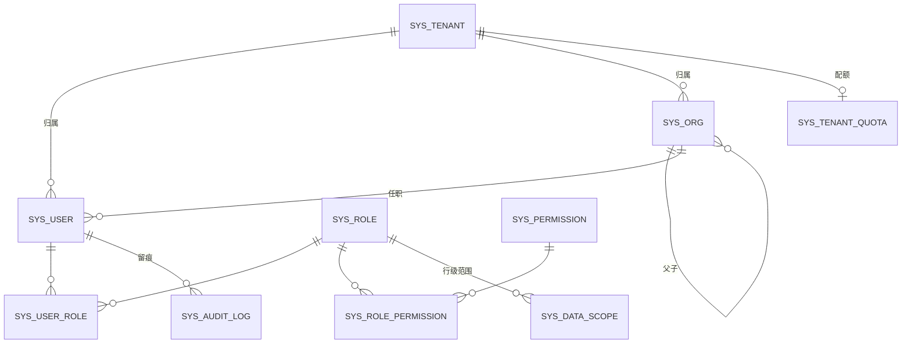
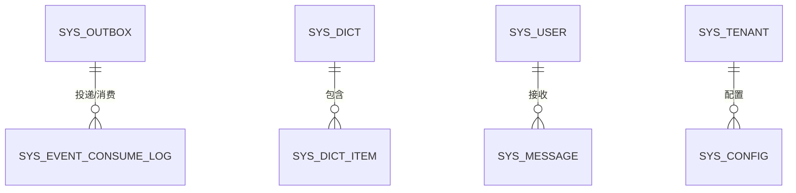
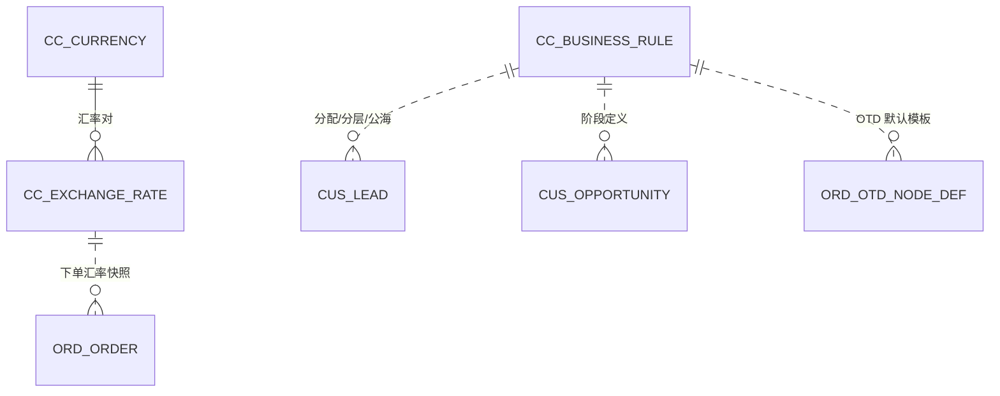
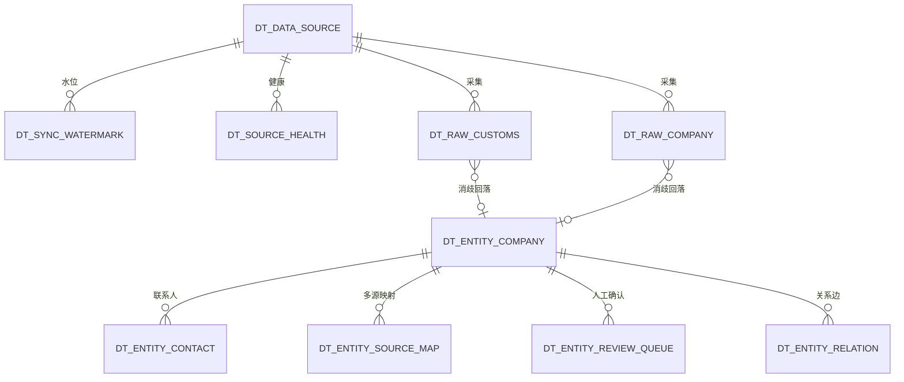
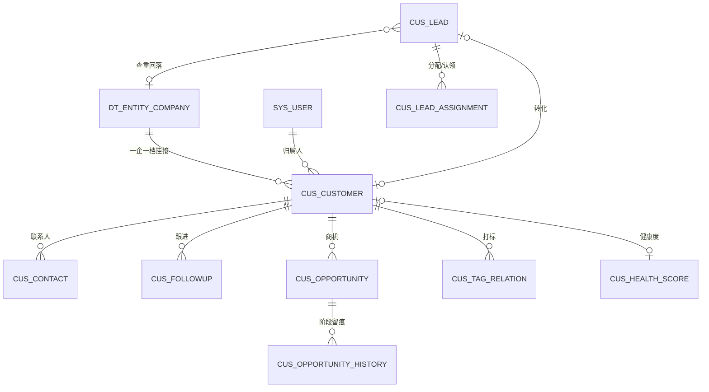
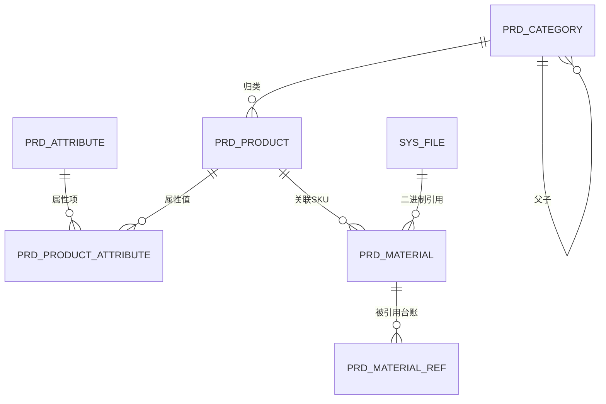
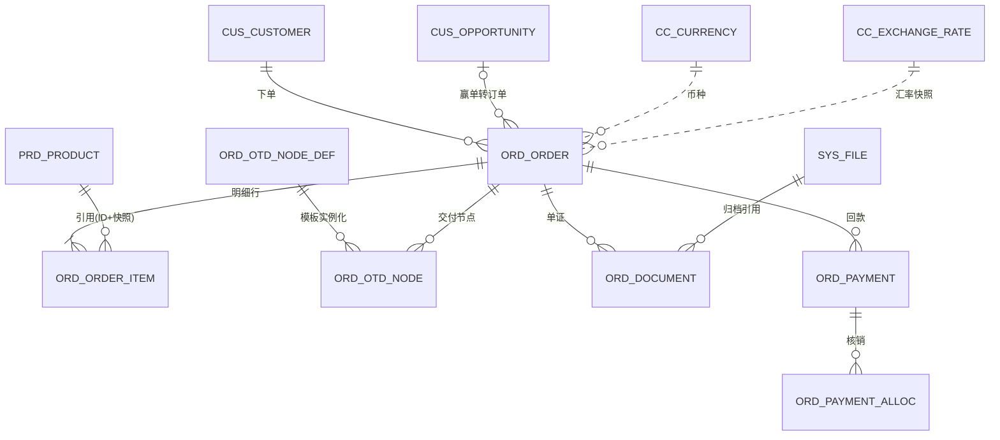
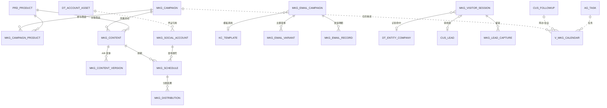

# 灵犀系统概念数据模型 · 实体清单（骨架主干）

> 版本：V0.6 草案（待评审） ｜ 2026-10-13 ｜ 任务：M0000-008（Wave 3 六域补全；V0.5 补营销日历派生视图；V0.6 **ADR-0004 已采纳 · `ag_task` 同日关联裁决留灵犀**）
> 配套：[概念数据模型-总览](./概念数据模型-总览.md)（范围/命名/公共约定/事件挂点见总览）
> 说明：本清单到**实体（表）与关系**粒度，不含字段级类型/索引/约束（字段级见各域《字段级数据字典-06~12》）。
> Wave 3（07~12）新增营销 / 市场情报 / 经营分析 / 智能体 / 知识中心 / 工作台六域；合规触达与会话域（`mkg_unsubscribe`/`mkg_freq_*`/`svc_session`）见《字段级数据字典-06》，本轮不在本清单展开（svc 工单/SLA 留后续 Wave）。

**图例**：`A`=P0-A 骨架批 · `B`=P0-B 增强批（登记不展开） · `机制`=平台公共机制 · `派生`=视图/物化视图/指标，不落事实表 · `红线`=命中即转人工 Review。

---

## 一、L0 平台核心

### 1.1 身份与权限（`sys_`）　`红线`

| 表名 | 中文名 | 职责 | 关键关系 | 功能编号 | 标注 |
|---|---|---|---|---|---|
| `sys_tenant` | 租户 | 多租户主体，Realm↔租户；租户级配置入口 | 1─N 所有业务表（`tenant_id`） | CC-13 底座 | A |
| `sys_tenant_quota` | 租户配额账本 | API/Token/存储/账号/发信量配额 | N─1 `sys_tenant` | 4.1 配额计量 | A `红线` |
| `sys_user` | 用户 | 用户主数据（认证权威在 Keycloak，本表存业务侧摘要/映射） | N─M `sys_role` | CC-13 | A |
| `sys_role` | 角色 | RBAC 角色，对齐五关键角色 | N─M `sys_user`/`sys_permission` | CC-14 | A |
| `sys_user_role` | 用户-角色 | 角色映射 | 关联 | CC-14 | A |
| `sys_permission` | 权限资源 | 功能权限码 `{域}:{对象}:{动作}` 注册 | 1─N `sys_role_permission` | CC-15 | A |
| `sys_role_permission` | 角色-权限 | 权限绑定（或以 `casbin_rule` 承载） | 关联 | CC-15 | A |
| `sys_data_scope` | 数据权限 | 行级范围 SELF/DEPT/DEPT_AND_SUB/CUSTOM/ALL；维度含归属人/部门/区域/市场 | N─1 `sys_role` | CC-16 | A `红线` |
| `sys_org` | 组织/部门树 | 部门与上下级，支撑 DEPT/DEPT_AND_SUB | 自关联 `parent_id`；1─N `sys_user` | CC-16 支撑 | A |
| `sys_audit_log` | 审计日志 | 谁/何时/何地/对什么/做了什么/改前改后；含 `source_type` | 全局；按月分区 | CC-18 | B |



### 1.2 公共机制（`sys_`）　`机制`

| 表名 | 中文名 | 职责 | 关键关系 | 规约 | 标注 |
|---|---|---|---|---|---|
| `sys_outbox` | 事件外发表 | 业务写与事件写同事务；轮询投递 Valkey Stream | 全业务域写入 | §4.7 | A `机制` |
| `sys_event_consume_log` | 消费幂等日志 | 按 `eventId` 去重，至少一次投递下的幂等保障 | 消费方写入 | §4.7 | A `机制` |
| `sys_idempotency` | 幂等键 | `X-Idempotency-Key`，按 `key+tenantId` 去重，24h | 写接口共享 | §4.3.3 | A `机制` |
| `sys_dict` / `sys_dict_item` | 字典 | 全局枚举/码表（白名单表，免 `tenant_id`） | 被各域引用 | §3.3 D3 | A `机制` |
| `sys_file` | 文件 | 对象存储预签名直传元数据 | 被 `prd_material`/`ord_document` 引用 | §4.9 C10 | A `机制` |
| `sys_message` | 站内通知 | 询盘/任务/系统/预警分级推送 | N─1 `sys_user` | UW-17~20 | A |
| `sys_config` | 租户级 KV 配置 | 运行期配置缓存（业务配置权威在 `cc_*`） | N─1 `sys_tenant` | §4.8.3 | A `机制` |



### 1.3 配置中心（`cc_`）

| 表名 | 中文名 | 职责 | 关键关系 | 功能编号 | 标注 |
|---|---|---|---|---|---|
| `cc_convention` | 企业公约 | 行业定义/品牌规范/合规准则/经营理念（JSONB，AI 生成约束源） | 被智能体/内容读取 | CC-01~04 | A |
| `cc_locale` | 语言包 | 界面文案 i18n（后端返消息码，前端消费） | 全局 | CC-05 | A |
| `cc_currency` | 币种 | ISO4217 币种字典 | 被金额类表引用 | CC-06 | A |
| `cc_exchange_rate` | 汇率快照 | 币种间汇率，随单据固化 | 被 `ord_order` 引用 | CC-06 | A |
| `cc_timezone` | 时区 | 全球时区管理 | 被用户/客户/排期引用 | CC-07 | A |
| `cc_business_rule` | 业务规则 | 线索分配/客户分层/公海/商机阶段/SLA/OTD 默认（配置化，禁写死） | 被 `cus_*`/`ord_*` 读取 | CC-09~12 | A |
| `cc_feature_toggle` | 功能开关 | `ff.{域}.{模块}.{功能}`，新模块默认关，按租户灰度 | 全局 | 4.14.2 | A |

> 变更留版本与操作人；企业公约/品牌规范变更须使相关提示词缓存失效（§3.5 F6）。



---

## 二、L1 数据底座（`dt_`）　壁垒层

| 表名 | 中文名 | 职责 | 关键关系 | 功能编号 | 标注 |
|---|---|---|---|---|---|
| `dt_data_source` | 数据源注册 | 三类数据源（搜索/社媒/海关/企业库）统一注册、频率、字段映射、凭证引用 | 1─N `dt_sync_watermark` | DT-01 | A |
| `dt_sync_watermark` | 增量水位 | 断点续跑水位（隧道友好，禁从头重跑） | N─1 `dt_data_source` | DT-01 | A |
| `dt_source_health` | 源健康 | 限速/重试/健康监控/质量标记 | N─1 `dt_data_source` | DT-01 | A |
| `dt_entity_company` | 企业实体（一企一档） | **枢纽**：统一实体 ID，多源消歧归并；规范化名称/域名落列 + `pg_trgm` GIN | 1─N 下列各 entity 表；被 `cus_customer` 挂接 | DT-02 | A |
| `dt_entity_contact` | 企业级联系人 | "人"的权威源（归属边界见待决策①） | N─1 `dt_entity_company` | DT-02 | A |
| `dt_entity_source_map` | 多源映射 | CUSTOMS/GLOBAL_DB/SOCIAL/CRM/MANUAL → 实体；记 `match_rule` | N─1 `dt_entity_company` | DT-02 | A |
| `dt_entity_review_queue` | 人工确认队列 | 弱匹配（国家+城市+行业+相似度≥0.85）进队列，纠错回写规则库 | N─1 `dt_entity_company` | DT-02/OP-CUS-07 | A |
| `dt_entity_relation` | 关系边 | CONTACT_OF/SAME_GROUP/SUPPLIER_OF/COMPETITOR_OF 等实体间关系 | N─1 `dt_entity_company`（两端） | DT-02 | A |
| `dt_raw_customs` | 海关交易明细 | 全球海关数据落地（采购商/供应商/进出口量），归并到实体 | N─1 `dt_entity_company`（回落） | GM-07 | A 派生 |
| `dt_raw_company` | 全球企业库记录 | 企业基本信息/经营品类/联系方式落地 | N─1 `dt_entity_company` | GM-08 | A 派生 |
| `dt_raw_search_trend` | 搜索指数明细 | Google Trends 等趋势/地域热度（可从源重建） | 关键词×地域×时间 | GM-01 | A 派生 |
| `dt_hot_keyword` / `dt_trend_keyword` | 热搜词库 / 趋势词库 | 按行业/品类/地区的热词与上升词 | 关联品类/市场 | GM-03/04 | A 派生 |
| `dt_metric_definition` | 指标定义 | `metric_code`/公式类型/`sql_template`/可用维度/可用筛选/单位/精度/责任人/版本；全系统统一口径 | 被分析/看板引用 | DT-05 | A |
| `dt_tag_definition` / `dt_tag_relation` | 标签体系(B) | 标签定义与自动打标关联（客户/线索/内容） | N─1 各业务实体 | DT-04 | B |
| `dt_quality_rule` / `dt_quality_issue` | 数据质量(B) | 完整性/唯一性/及时性/一致性/有效性规则与问题清单 | 跨域扫描 | DT-06 | B |

> 归并**必须可逆**（`is_merged` + `merged_into_id`，不物理删除）；强匹配=域名或规范化名称一致自动归并，弱匹配（相似度≥0.85）进 `dt_entity_review_queue`。外部明细为派生落地，可重建；落 L1 还是 intel 见待决策②。



---

## 三、L2 客户域（`cus_`）：线索 / 客户 / 商机（三中心）

> V2.1 起本域承载**三层对象**（线索 → 客户 + 商机，**对象流转序**），对应三个并列一级菜单「客户中心 / 商机中心 / 线索中心」（**菜单排列序**）；表名前缀不拆域，仍统一 `cus_`。

| 表名 | 中文名 | 职责 | 关键关系 | 功能编号 | 标注 |
|---|---|---|---|---|---|
| `cus_customer` | 客户档案〔客户中心〕 | 基础信息/来源/**客户类型（新潜 / 首次成交 / 复购，E59）**/**价值分层 S/A/B/C/D（E28）**，`entity_id` 回落企业实体（一企一档）；~~`stage`（原由商机归并的派生冗余）~~ **V2.1.1 停用** | N─1 `dt_entity_company`；N─1 `sys_user`（归属人） | OP-CUS-01/BO-SAL-08 | A |
| `cus_contact` | 客户联系人〔客户中心〕 | 客户内联系人及角色（决策人/采购/技术/财务），多通道联系方式；与 `dt_entity_contact` 边界见待决策① | N─1 `cus_customer` | OP-CUS-03 | A |
| `cus_followup` | 跟进记录〔客户域共用〕 | 时间/方式/结果/下一步；智能体生成草稿→人审生效；全旅程时间轴数据源。**以客户为主体，可空挂商机** | N─1 `cus_customer`；可空 N─1 `cus_opportunity` | OP-CUS-02/BO-SAL-10 | A `source_type` |
| `cus_lead` | 线索〔线索中心〕 | 全渠道归集、评分分级、来源；**状态 待联系 / 已转化 / 无效（E25，3 态）**；查重走企业实体消歧；**转化后回链 `converted_customer_id`** | 回落 `dt_entity_company`；|o--o| `cus_customer`（转化） | BO-SAL-01/03/06、OP-LEAD-01 | A `source_type` |
| `cus_lead_assignment` | 线索分配/认领/公海回收〔线索中心〕 | 指派、认领、公海回收流转留痕；规则来自 `cc_business_rule` | N─1 `cus_lead`；N─1 `sys_user` | OP-CUS-04/BO-SAL-13 | A |
| `cus_opportunity` | 商机〔商机中心〕 | **阶段推进（7 阶段，E27）**、**关闭结果（成交关闭/流失关闭，E57）**、**意向等级（A/B/C/D，仅评未关闭商机，E58）**、金额/预计成交日/概率；阶段定义来自 `cc_business_rule`；**禁止孤儿商机** | N─1 `cus_customer`（1:N）；可空 N─1 `cus_lead` | OP-CUS-05/BO-SAL-14、OP-OPP-01~04 | A |
| `cus_opportunity_history` | 商机阶段留痕〔商机中心〕 | 阶段变更时间/停留时长，支撑超时预警与输单分析 | N─1 `cus_opportunity` | BO-SAL-14/17/18 | A |
| `cus_tag_relation` | 客户标签/分层(B) | 多维标签与**价值分层结果（S/A/B/C/D）** | N─1 `cus_customer`；引用 `dt_tag_definition` | OP-CUS-06/BO-SAL-11/12 | B |
| `cus_health_score` | 客户健康度(B) | 基于互动频次/商机/订单的健康度与流失风险 | N─1 `cus_customer` | OP-CUS-08 | B |

> 公海为线索/客户的归属状态 + 回收规则（`cc_business_rule` 配置化），流转由 `cus_lead_assignment` 承载，不另建主数据表。沟通记录自动归档（OP-CUS-11）聚合邮件/WhatsApp/社媒，落到 `cus_followup` 时间轴 + 消息域（mkg，本轮不展开）。
> **V2.1 关键约束**：① ~~**客户 `stage` 不独立维护** —— 由名下商机归并派生~~（**V2.1.1 起该字段停用**：客户不设阶段，只按「客户类型 + 客户价值分层」两个维度分类）；② **成交回流** —— 商机 `close_status='WON'` 时按该客户此前是否已有成交把 `customer_type` 置为 `FIRST_DEAL` 或 `REPEAT`、刷新 `last_deal_at`，由事件消费完成，**禁止跨模块直改对方表**；③ **意向 ≠ 价值** —— `cus_opportunity.intent`（A/B/C/D）与 `cus_customer.tier`（S/A/B/C/D）是两套等级，不得混用。



---

## 四、L2 商品中心（`prd_`）

| 表名 | 中文名 | 职责 | 关键关系 | 功能编号 | 标注 |
|---|---|---|---|---|---|
| `prd_product` | 商品主数据(SKU) | 品名/规格/品牌/分类/HS 编码/多语言信息（JSONB） | N─1 `prd_category` | OP-PRD-01 | A |
| `prd_category` | 品类树 | 商品分类层级（基础归类） | 自关联 `parent_id`；1─N `prd_product` | OP-PRD-01/03 | A |
| `prd_attribute` | 属性定义/模板 | 属性项、可选值、适用品类模板 | 1─N `prd_product_attribute` | OP-PRD-03 | B |
| `prd_product_attribute` | 商品属性值 | 商品-属性项-取值 | N─1 `prd_product`；N─1 `prd_attribute` | OP-PRD-03 | B |
| `prd_material` | 素材(图片/视频) | 上传/分类/打标/多语言版本/关联 SKU；二进制经 `sys_file` 预签名直传 | N─1 `prd_product`；N─1 `sys_file` | OP-PRD-02 | A `source_type` |
| `prd_material_ref` | 素材引用台账 | 素材被内容/商品引用关系与次数统计 | N─1 `prd_material` | OP-PRD-06 | B |

> 数据完整度检查（OP-PRD-04，P0-A）为派生计算 + 补全清单，走视图/物化视图，不落事实表；AI 补全建议（HS 编码/属性）回写时带 `source_type=AGENT`。素材批量处理（OP-PRD-05）为处理能力，不新增表。



---

## 五、L2 订单交付（`ord_`）

| 表名 | 中文名 | 职责 | 关键关系 | 功能编号 | 标注 |
|---|---|---|---|---|---|
| `ord_order` | 订单头 | 录入/修改/状态流转；金额（最小单位）+ 币种 + 汇率快照；多语言单据 | N─1 `cus_customer`；可引用 `cus_opportunity` | OP-ORD-01 | A `source_type` |
| `ord_order_item` | 订单明细行 | 商品行/数量/单价/金额；引用商品 `ID + 展示快照` | N─1 `ord_order`；N─1 `prd_product` | OP-ORD-01 | A |
| `ord_otd_node_def` | OTD 节点模板 | 默认模板 + 企业可配（增删/改名/标准工期/预警提前量）；默认来自 `cc_business_rule` | 1─N `ord_otd_node` | OP-ORD-05 | A |
| `ord_otd_node` | OTD 节点实例 | 订单一路节点的计划/实际完成时间、超期标记（订单确认→排产→生产完工→出运→报关→到港→签收） | N─1 `ord_order`；N─1 `ord_otd_node_def` | OP-ORD-02 | A |
| `ord_document` | 单证 | 合同/发票/装箱单/提单归档，引用 `sys_file` | N─1 `ord_order` | OP-ORD-03 | B |
| `ord_payment` | 回款 | 回款登记、应收账期、逾期预警 | N─1 `ord_order` | OP-ORD-03/07 | B |
| `ord_payment_alloc` | 回款核销 | 回款与订单/单证核销关联 | N─1 `ord_payment`；N─1 `ord_order` | OP-ORD-03 | B |

> 利润与业绩（OP-ORD-08/09）、OTD 准时率与异常看板（P0-B 归因）均为**派生**（物化视图 / 指标），不落事实表；指标口径统一走 `dt_metric_definition`。订单金额对账任务保障与汇总一致（§4.8）。



---

## 六、L2 营销中心（`mkg_`）

> 租户私域；营销是本轮**唯一严格以前端 `marketing/*-data.ts` 消费字段校准**的域。合规退订/频控/统一会话见《字段级数据字典-06》，本域只交叉引用不重建；内容/邮件的自主度策略与拦截规则归口元枢 `com.yuanshu.ac`，本侧仅 `*_ref` 逻辑引用。

| 表名 | 中文名 | 职责 | 关键关系 | 功能编号 | 标注 |
|---|---|---|---|---|---|
| `mkg_campaign` | 营销活动主表 | 类型/目标/预算/状态/负责人/起止/渠道；受众 `audience`(E81)+`conflict_group_id` 供日历 R1；`participants`/`gmv` 为派生 | N─M `prd_product`；N─1 `sys_user` | OP-MKT-01/02 | A `source_type` |
| `mkg_campaign_product` | 活动-参与商品 | 活动与商品 N:M 关联（主推/搭配） | N─1 `mkg_campaign`；N─1 `prd_product` | OP-MKT-02 | B |
| `mkg_content` | 内容清单 | 图文/视频、多语言每语种一行、待审态；`code` 业务键；对外内容必人审 | N─1 `mkg_campaign`/`prd_product`/`sys_file` | OP-MKT-05/06 | A `source_type` `红线` |
| `mkg_content_version` | 内容 A/B 多版本 | 变体标号与效果（择优） | N─1 `mkg_content` | OP-MKT-07 | B |
| `mkg_schedule` | 内容排期 | 内容×渠道×账号×「当地日期+时刻+IANA 时区」，冲突检测 | N─1 `mkg_content`/`mkg_social_account` | OP-MKT-03/11 | A |
| `mkg_distribution` | 分发/发布记录 | 发布结果与回执（触达/曝光/互动），按月分区 | N─1 `mkg_schedule`/`mkg_content` | OP-MKT-08/09 | A `source_type` |
| `mkg_social_account` | 社媒账号资产 | 平台/账号/地区/授权态/到期预警/健康度；凭证走 `dt_account_asset` 引用不存明文 | N─1 `dt_account_asset`；N─1 `sys_user` | OP-MKT-01/05 | A `红线` |
| `mkg_email_campaign` | EDM 活动 | 受众分群/状态/多变量；AI 写信；金额最小单位+币种 | N─1 `kc_template`/`mkg_campaign` | BO-MKG-08 | A `source_type` |
| `mkg_email_variant` | EDM A/B 主题变体 | 主题行 + 漏斗（送达/打开/点击/退信按变体分记） | N─1 `mkg_email_campaign` | BO-MKG-08/16 | A |
| `mkg_email_record` | 发信明细/送达回执 | 逐收件人送达/打开/点击/退订回链，按月分区 | N─1 `mkg_email_campaign` | BO-MKG-18/21 | B 追加型 |
| `mkg_visitor_session` | 网站访客会话 | 企业识别/来源/匹配（命中未建客户→转线索）/待触达，按月分区 | N─1 `dt_entity_company`；→ `cus_lead`/`cus_customer` | BO-MKG-28~33 | A `source_type` |
| `mkg_lead_capture` | 留资表单 | 订阅/询价留资 → 转化生成线索（不新建客户） | N─1 `mkg_visitor_session`；→ `cus_lead` | BO-MKG-32 | B |
| `mkg_placement` | 投放明细 | 计划名/渠道/周期/曝光/花费/线索/CPL（效果与基础信息同表） | N─1 `mkg_campaign` | BO-MKG-40/41 | P1 |
| `mkg_whatsapp_task` | WhatsApp 群发/预热 | 号码获取/预热/防反垃圾/多方式发送 | 引用 06 `mkg_freq_*`/`mkg_unsubscribe` | BO-MKG-22~27 | P1 |
| `v_mkg_calendar` | 营销日历（派生视图） | 跨域归一时间轴（campaign/visit/meeting/ticket/task）+ R1 同受众×同时段冲突检测，不落事实表 | 投影 `mkg_campaign`/`cus_followup`/`svc_*`/`ag_task` | OP-MKT-08/11 | 派生 |

> **交叉引用不重复**：`mkg_unsubscribe`（`source_campaign_id` 反指本域 `mkg_campaign`）、`mkg_freq_rule`/`mkg_freq_counter`、`svc_session`(+message) 均在《字段级数据字典-06》；账号凭证引用 `dt_account_asset`（02 §1.4）+ `sys_file`。



---

## 七、L2 市场情报（`intel_`）

> Wave 0 裁决 ②：外部明细落 L1 `dt_raw_*`/`dt_hot_keyword`/`dt_trend_keyword`，`intel` **只出视图与报告、不落事实表**。报告正文向量化归口元枢 `com.yuanshu.sem`。

| 表名 | 中文名 | 职责 | 关键关系 | 功能编号 | 标注 |
|---|---|---|---|---|---|
| `v_intel_search_trend` | 搜索趋势视图 | ← `dt_raw_search_trend`（关键词×地域×周期+环比） | 投影 L1 | GM-01 | 派生 |
| `v_intel_hot_keyword` / `v_intel_rising_keyword` | 热搜 / 上升词视图 | ← `dt_hot_keyword` / `dt_trend_keyword` | 投影 L1 | GM-03/04 | 派生 |
| `v_intel_trade_flow` | 贸易流向视图 | ← `dt_raw_customs`（HS×国家对×月聚合） | 投影 L1；关联 `prd_product.hs_code` | GM-07 | 派生 |
| `intel_keyword_watch` | 监控关键词清单 | 租户圈定监控词 + 阈值预警（命中发 `lx.intel.keyword.changed`） | N─1 `sys_user` | BO-MKT-09 | P1 |
| `intel_opportunity_report` | 产品机会 / 市场容量报告 | 报告快照 JSONB（趋势/贸易/竞品凝固），状态 E73 | N─1 `prd_product`；→ `cus_opportunity` | BO-MKT-10/11/13 | A `source_type` |

```mermaid
erDiagram
  DT_RAW_SEARCH_TRENDO ..v_INTEL_SEARCH_TREND : "投影"
  DT_HOT_KEYWORD ..v_INTEL_HOT_KEYWORD : "投影"
  DT_RAW_CUSTOMS ..v_INTEL_TRADE_FLOW : "投影"
  INTEL_KEYWORD_WATCH ..> SYS_MESSAGE : "预警进工作台"
  PRD_PRODUCT ||--o{ INTEL_OPPORTUNITY_REPORT : "关联商品"
```

---

## 八、L2 经营分析（`ana_`）

> 指标口径复用平台 `dt_metric_definition`；看板/漏斗/ROI/资产/效率走物化视图 `mv_ana_*`（可随口径重建）。仅预警/报告/取数日志落库。

| 表名 | 中文名 | 职责 | 关键关系 | 功能编号 | 标注 |
|---|---|---|---|---|---|
| `mv_ana_kpi_overview` | 经营总览 KPI | GMV/订单/线索/商机/赢率/ROI 物化 | 复用指标；聚合多域 | DM-01 | 派生 |
| `mv_ana_sales_funnel` | 销售漏斗 | 7 阶段商机数/额/转化率 | ← `cus_opportunity`（E27） | DM-03 | 派生 |
| `mv_ana_roi` | 营销/投放 ROI | 花费/归因 GMV/线索/CPL | ← `mkg_*`（07） | DM-04 | 派生 |
| `mv_ana_customer_asset` | 客户资产盘点 | 分层/类型/ARPU/流失风险/健康度 | ← `cus_customer`/`cus_health_score` | OP-BA-01 | 派生 |
| `mv_ana_agent_efficiency` | 智能体效率 | 任务数/完成/需人工/接管/耗时/成本 | ← 聚合 `ag_task`（10） | OP-BA-02 | 派生 |
| `ana_alert_rule` | 预警规则 | 五类预警（流失/订单异常/OTD 延期/营销下滑/商机停滞）阈值/级别/渠道 | 引用 `dt_metric_definition`；N─1 `sys_user` | OP-BA-03 | A |
| `ana_alert` | 预警事件 | 规则命中实例，分级处理闭环（E75），按月分区 | N─1 `ana_alert_rule`；biz_ref 逻辑引用各域 | OP-BA-03 | A 追加型 |
| `ana_report` | 经营/决策报告 | 内部经营报告快照 | 复用指标；正文向量化归元枢 | DM-17 | B |
| `ana_nlq_log` | 问答式取数日志 | LLM 只出结构化参数，执行走受控模板；按月分区 | 引用 `dt_metric_definition` | DM-02/UW-04 | B 追加型 |

```mermaid
erDiagram
  DT_METRIC_DEFINITION ||..o{ MV_ANA_KPI_OVERVIEW : "口径"
  CUS_OPPORTUNITY ..v_MV_ANA_SALES_FUNNEL : "聚合"
  AG_TASK ..v_MV_ANA_AGENT_EFFICIENCY : "聚合"
  ANA_ALERT_RULE ||--o{ ANA_ALERT : "命中"
  ANA_ALERT ..> SYS_MESSAGE : "推送工作台"
```

---

## 九、L3 智能体（`ag_`·仅业务运行面）

> **🔴 归口边界**：只建 AG-01~06 运行/业务面（实例名册、任务、轨迹、待审、接管）。注册中心/自主度策略/协作总线/越界拦截规则/监控看板配置（AG-07~09、AC-01~09）归元枢 `com.yuanshu.ac`，本侧仅 `autonomy_policy_ref`/`agent_reg_ref` 逻辑引用；`ag_task` 即 00 §三 `source_task_id` 所指。

| 表名 | 中文名 | 职责 | 关键关系 | 功能编号 | 标注 |
|---|---|---|---|---|---|
| `ag_agent_instance` | 六智能体业务实例名册 | AG-01~06 业务映射（启用/授权范围）；`*_ref` 逻辑引用元枢 | → 元枢 `com.yuanshu.ac`；N─1 `sys_user` | AG-01~06 | A `红线` |
| `ag_task` | 智能体任务 | 业务对象/目标/发起用户/状态机（E76）/产出/耗时/成本 | 被各域 `source_task_id` 回指；biz_obj 逻辑引用各域 | AG-* | A `source_type` |
| `ag_task_trace` | 执行轨迹 | 步骤/工具调用/拦截命中（规则权威在元枢），按月分区 | N─1 `ag_task` | AG-*/UW-* | B 追加型 |
| `ag_pending_review` | 待审队列 | 对外内容/开发信人工审（UW-24），引用被审对象不复制内容 | N─1 `ag_task`；reviewee → `mkg_content`/`svc_session` | UW-24 | A `红线` |
| `ag_takeover` | 接管留痕 | 暂停/接管/终止/退回（E78）+ 上下文快照（UW-11 铁律） | N─1 `ag_task`；N─1 `sys_user` | UW-11 | A |

```mermaid
erDiagram
  AG_AGENT_INSTANCE ||--o{ AG_TASK : "执行者"
  AG_TASK ||--o{ AG_TASK_TRACE : "步骤轨迹"
  AG_TASK ||--o{ AG_PENDING_REVIEW : "待审产出"
  AG_TASK ||--o{ AG_TAKEOVER : "人工干预"
  AG_PENDING_REVIEW }o--o| MKG_CONTENT : "审内容"
  AG_PENDING_REVIEW }o--o| SVC_SESSION : "审会话"
  AG_AGENT_INSTANCE ..> YUANSHU_AC : "自主度/注册 逻辑引用"
```

---

## 十、L2 知识中心（`kc_`·仅内容面）

> **🔴 归口边界**：只建 KC-07~15 内容面（模板/话术/问答 + 调用台账）。知识引擎框架/文档托管 KC-01~06 归元枢 `com.yuanshu.sem`、提示词库 KC-16~19/22 归元枢；本侧内容行向量仅存 `embedding_ref` 逻辑引用。

| 表名 | 中文名 | 职责 | 关键关系 | 功能编号 | 标注 |
|---|---|---|---|---|---|
| `kc_template` | 内容模板 | 开发信/报价/合同/跟进/售后模板，多语言正文+变量 | 被 `mkg_email_campaign` 调用；→ 元枢 `embedding_ref` | KC-07~09 | A |
| `kc_script` | 标准话术 | 接待/客服/销售话术 + 场景分类（复用 E53） | 被智能体/`svc_session` 引用 | KC-10~12 | A |
| `kc_qa` | 标准问答对 | FAQ 问答 + 分类（RAG 检索） | 引用元枢向量 | KC-13~15 | B |
| `kc_content_usage` | 调用台账 | 内容被智能体/营销引用次数，按月分区 | N─1 `kc_*`；→ `ag_task` | KC-* | B |

```mermaid
erDiagram
  KC_TEMPLATE ||--o{ MKG_EMAIL_CAMPAIGN : "被调用"
  KC_SCRIPT ..> SVC_SESSION : "应答引用"
  KC_TEMPLATE ||--o{ KC_CONTENT_USAGE : "调用统计"
  KC_QA ..> YUANSHU_SEM : "embedding_ref 向量"
```

---

## 十一、L4 工作台与角色工作台（`wb_` / `rw_`）

> 聚合层，不产生新事实：待办/KPI 为跨域派生视图；通知复用 `sys_message`（01）不新建；权限仍由 `sys_data_scope`+RLS 裁决。本域不新增领域事件（消费他域事件驱动待办）。

| 表名 | 中文名 | 职责 | 关键关系 | 功能编号 | 标注 |
|---|---|---|---|---|---|
| `v_wb_todo` | 统一待办视图 | 聚合线索分配/内容待审/经营预警/情报预警/OTD 延期/工单/账号到期 | 投影 8+ 源域（只读不物化） | WB | 派生 |
| `mv_rw_kpi` | 角色工作台 KPI 卡 | 复用 `mv_ana_*`/指标按角色圈定子集 | ← `ana`/`dt_metric_definition` | RW-* | 派生 |
| `rw_workbench_config` | 角色工作台布局配置 | 五角色（RW-01~05）默认/租户覆写布局 `layout_json` + KPI/待办订阅 | N─1 `sys_role`；N─1 `sys_user` | RW-01~05/UW-03 | A |
| `rw_user_preference` | 用户偏好/多岗切换 | 活动角色视图等 UI 偏好（不放权） | N─1 `sys_user` | UW-21 | B |

```mermaid
erDiagram
  SYS_ROLE ||--o{ RW_WORKBENCH_CONFIG : "角色布局"
  RW_WORKBENCH_CONFIG ||--o{ RW_USER_PREFERENCE : "个性化覆写"
  CUS_LEAD ..v_WB_TODO : "待办聚合"
  ANA_ALERT ..v_WB_TODO : "待办聚合"
  AG_PENDING_REVIEW ..v_WB_TODO : "待办聚合"
  SYS_USER ||--o{ SYS_MESSAGE : "通知复用"
```

---

## 十二、跨域关系与状态机汇总

### 12.1 端到端主线

```
dt_entity_company（一企一档枢纽）
   ← cus_customer ← cus_lead（查重回落）
   cus_lead ──核验合格·转化──→ cus_customer ──1:N 挂载──→ cus_opportunity
   cus_opportunity ──成交关闭·回流──→ cus_customer.customer_type（NEW_POTENTIAL → FIRST_DEAL / REPEAT）
   cus_opportunity ──已签约──→ ord_order → ord_order_item → prd_product
   ord_order → ord_otd_node（模板 ord_otd_node_def）→ ord_payment → ord_payment_alloc
   mkg_campaign → mkg_content →(人审 ag_pending_review)→ mkg_schedule → mkg_distribution（对外内容必人审 §3.6 G4）
   ag_task（智能体产出，带 source_task_id）→ 回写 mkg_content/intel_opportunity_report/... ；异常/接管 → ag_pending_review / ag_takeover
   ana_alert_rule 命中 → ana_alert → v_wb_todo（工作台待办）；指标口径统一 dt_metric_definition
   所有租户表 → tenant_id 隔离 + RLS 兜底 + sys_outbox 事件（灵犀侧 lx.*，元枢侧 ys.*）
```

### 12.2 状态机落点（状态定义集中枚举，流转表显式声明，Spring StateMachine 承载）

| 对象 | 表 | 状态（草案，字段级细化固化） |
|---|---|---|
| 线索 | `cus_lead` | 待联系 → 已转化 / 无效（E25，**3 态**；分配状态由 `owner_user_id` + 分配流水表达，不占状态位） |
| 商机 | `cus_opportunity` | 首触 → 跟进培育 → 方案报价 → 商务谈判 → 已签约 → 交付中 → 已验收（E27，**V2.1.1 起 7 阶段**，阶段来自 `cc_business_rule`）；兜底关闭 = 成交关闭 / 流失关闭（E57） |
| 商机意向 | `cus_opportunity.intent` | A 高意向 / B 中意向 / C 低意向 / D 无效（E58，**仅评未关闭商机**，标 A 需 BANT 四要素齐备） |
| 客户类型 | `cus_customer.customer_type` | 新潜客户 → 首次成交客户 → 复购客户（E59，由商机成交关闭事件驱动；判定＝客户级成交次数 0 / 1 / ≥2） |
| 订单 | `ord_order` | 草稿→已确认→生产中→已发运→已到货→已签收→已关闭 |
| OTD 节点 | `ord_otd_node` | 未开始→进行中→已完成/已延期 |
| 营销活动 | `mkg_campaign.status` | 草稿→待审→进行中→已结束（E62，驳回回草稿） |
| 营销内容 | `mkg_content.status` | 待审→生成中→已分发（E64，对外内容必人审） |
| EDM | `mkg_email_campaign.status` | 草稿→发送中→已发→暂停（E69） |
| 社媒授权 | `mkg_social_account.auth_status` | 已连→即将到期→已过期→已吊销（E68） |
| 情报报告 | `intel_opportunity_report.status` | 生成中→就绪→归档（E73） |
| 经营预警 | `ana_alert.status` | 新→已确认→已处理→已关闭（E75） |
| 智能体任务 | `ag_task.status` | 创建→排队→运行→完成/暂停/已接管/需人工/失败（E76） |
| 待审队列 | `ag_pending_review.status` | 待审→通过/驳回（复用 E18） |
| 统一会话 | `svc_session.status` | 见《字段级数据字典-06》E52（本轮不展开） |

> 禁止业务代码散落 `if (status == ...)`；状态变更同时发领域事件。

### 12.3 派生与视图（不落事实表）

| 能力 | 承载 | 功能编号 |
|---|---|---|
| 客户 360 / 一企一档视图 | 视图 / 物化视图 `mv_*`（聚合实体 + 联系人 + 商机 + 订单 + 售后） | BO-SAL-08 |
| ~~客户所处阶段（`cus_customer.stage`）~~ | ⛔ **V2.1.1 取消**：客户不设阶段（阶段是**商机**的属性），客户分类只保留「客户类型 + 客户价值分层」两个维度；口径见《产品规划说明书V2.1.1》§3.4 | OP-CUS-01 |
| 销售漏斗 / 增购 · 复购识别 | 派生指标：漏斗**只计未关闭商机**（首触 / 跟进培育 / 方案报价 / 商务谈判）；增购 / 复购按**成交事实**判定（客户级 `last_deal_at` ＋ 成交侧商机的产品集），不用客户类型、也不用当前页切片 | DM-03、OP-OPP-04 |
| 数据完整度检查 | 派生计算 + 补全清单 | OP-PRD-04 |
| 利润 / 业绩 / OTD 准时率 | 物化视图 / 指标定义 | OP-ORD-08/09、OP-ORD-06 |
| 经营看板 / 问答式取数 | 指标定义 + 物化视图（LLM 只出结构化参数，服务端拼 SQL） | DM-01/02 |
| 市场情报视图 | `v_intel_*`（← L1 `dt_raw_*`/词库，Wave 0 ② 不落事实表） | GM-01/03/04/07 |
| 经营分析物化视图 | `mv_ana_*`（KPI/漏斗/ROI/客户资产/智能体效率，复用指标口径） | OP-BA-01/02 |
| 统一待办 / 角色 KPI | `v_wb_todo`（跨域聚合，只读）/ `mv_rw_kpi`（复用 `mv_ana_*`） | WB / RW-01~05 |

---

## 变更与版本记录

| 版本 | 日期 | 变更 | 操作人 |
|---|---|---|---|
| V0.1 草案 | 2026-09-11 | 首版实体清单（平台 sys/cc · 数据底座 dt · 客户 cus · 商品 prd · 订单 ord）+ 分域 ER + 跨域汇总 | 待评审 · AI 产出（人工主导 M0000-008） |
| **V0.2** | **2026-09-24** | **客户域改为三层对象并标注归属菜单**：章标题改「L2 客户域（`cus_`）：线索 / 客户 / 商机（三中心）」；`cus_customer` 补客户类型 E59 与价值分层 E28，`stage` 明确为**派生冗余**；`cus_lead` 状态收敛 **3 态**（E25）并补转化回链；`cus_opportunity` 补 **8 阶段**（E27）/ 关闭状态（E57）/ 意向等级（E58）；§6.1 主干补转化与回流链路；§6.2 状态机表补意向、客户类型两行；§6.3 补客户阶段派生与漏斗口径；三中心表述统一为**菜单排列序**「客户中心 / 商机中心 / 线索中心」（主档锚定 + 交付批次：一期客户 + 商机，线索 P2 居末），与**对象流转序**（线索 → 客户 + 商机）区分 | AI 产出（人工主导） |
| **V0.3** | **2026-09-25** | **同步产品 V2.1.1 客户分类口径收敛**：① `cus_opportunity` 状态由 **8 阶段改 7 阶段**（去掉待建联）；② `cus_customer.type`（E59）由 2 值改 **3 值**（新潜 / 首次成交 / 复购），§6.2 状态机表与 §6.1 回流链同步；③ **`cus_customer.stage` 停用**，§6.3 该行标取消（客户不设阶段），客户分类只保留「类型 + 价值分层」两个维度；④ §6.3 增购 / 复购判据改为**成交事实** | AI 产出（人工主导） |
| **V0.4** | **2026-10-12** | **Wave 3 六域补全（M0000-008 续）**：新增六章营销 `mkg_`（14 表，含 2 登记 P1）、七章市场情报 `intel_`（4 视图 + 2 表，遵循 Wave 0 ②）、八章经营分析 `ana_`（5 物化视图 + 4 表）、九章智能体 `ag_`（5 表仅业务面）、十章知识中心 `kc_`（4 表仅内容面）、十一章工作台 `wb_`/`rw_`（2 派生视图 + 2 配置表），各带分域 ER 与归口脚注；原「六、跨域汇总」顺延为「十二」，§12.1 主线补营销/智能体/预警链路、§12.2 状态机表补活动/内容/EDM/社媒/报告/预警/任务/待审八行、§12.3 派生表补 intel/ana/工作台三行。🔴 归口元枢项（注册/自主度/拦截/提示词/知识引擎）仅 `*_ref` 逻辑引用不建表；合规 `svc_session`/`mkg_unsubscribe`/`mkg_freq_*` 交叉引用 06 不重建。字段级见 07~12。**待评审 · AI 产出（人工主导）** |
| **V0.5** | **2026-10-13** | **三方一致性复核补丁（营销日历）**：六章营销新增派生视图 `v_mkg_calendar`（跨 campaign/visit/meeting/ticket/task 归一 + R1 冲突检测，不落事实表），`mkg_campaign` 补 `audience`(E81)/`conflict_group_id` 列，营销 ER 图补日历投影边；同步 00 新增枚举 E81、07 字典 V0.2。营销域计数由「14 表」→「14 表 + 1 派生视图」。仅追加，未动白名单/未出 DDL。**待评审 · AI 产出（人工主导）** |
| **V0.6** | **2026-10-13** | **ADR-0004 已采纳 · 实体中心与触达资产红线结案 + `ag_task` 同日裁决**：① 实体中心采公域共享 (`dt_entity_company`/`contact` 白名单保留) + `cus_entity_overlay` 私域覆盖（本 ADR 授权建模、字段级另开 Wave）；② `dt_entity_source_map`/`review_queue` 由白名单**转租户私域**（DDL 归后续 Wave）；③ `dt_account_asset`/`mkg_social_account`/`mkg_unsubscribe` 定为租户私域；④ 工单 `svc_*` 一期按租户私域；⑤ **`ag_task` 留灵犀域**（元枢不建实例表）。V0.4 行尾的🔴 “归口元枢仅逻辑引用”仍属既定约束保留；B1/B2/B3 跨产品契约仍待裁决。**AI 产出（人工主导）· 待评审** |