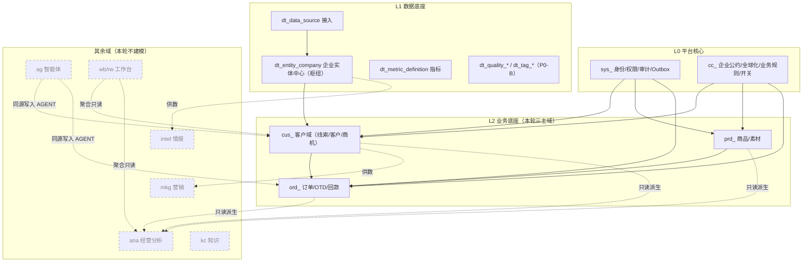
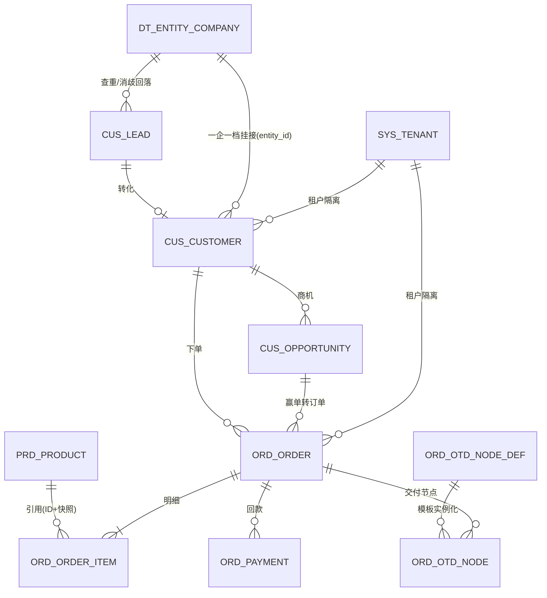

# 灵犀系统概念数据模型 · 总览（骨架主干）

> 版本：V0.1 草案（待评审） ｜ 2026-09-11
> 任务：M0000-008（02-data 数据模型缺口）
> 定位：基于《产品规划说明书2.0》《功能清单V2.0》《技术架构和组件选型方案2.0》《技术规约2.0》，产出**概念级**数据模型——实体清单 + 关系 + 数据层约定。
> 效力：**草案**。经人工评审确认前不视为冻结；确认后作为建表（Flyway）与契约（03-api）细化的权威基线。
> 配套：[概念数据模型-实体清单](./概念数据模型-实体清单.md)

---

## 一、范围与排除项

**本轮纳入（概念级，骨架主干优先）**：

- **L0 平台核心**：身份与权限（`sys_`）、公共机制（`sys_`）、配置中心（`cc_`）。
- **L1 数据底座**：数据接入、企业实体中心（壁垒枢纽）、指标/标签/质量（`dt_`）。
- **L2 业务三主域**：客户域（`cus_`：线索 / 客户 / 商机，对应「客户中心 / 商机中心 / 线索中心」三个一级菜单）、商品中心（`prd_`）、订单交付（`ord_`）。

**本轮明确不做**：

- 字段级类型 / 索引 / 约束清单、Flyway DDL、OpenAPI 契约（03-api）。
- 营销（mkg）/ 市场情报（intel）/ 经营分析（ana）/ 智能体（ag）/ 知识中心（kc）/ 工作台与角色工作台（wb/rw）等其余域——仅在全局分层图中以**占位**示意，不展开建模。

**设计顺序遵循产品架构结论**：`L1 → L2 → L3 → L4`；且**企业实体中心必须与客户中心同期建设**，故本轮二者一并纳入主干。

---

## 二、命名与口径收敛

数据库表名统一按《技术规约2.0》§2.6 命名总则：`{域}_{实体}` 小写下划线，域前缀见下表。

> **收敛点**：《技术架构和组件选型方案2.0》§4.4 示例写作 `data_entity_company`；本模型按技术规约（唯一技术规范）统一为 **`dt_entity_company`**。全文档以此为准。

| 域 | 前缀 | 归属模块 | 说明 |
|---|---|---|---|
| 平台公共（L0） | `sys_` | lingxi-platform | 租户/用户/角色/权限/组织/审计/Outbox/字典/文件/通知/配置 |
| 配置中心 | `cc_` | lingxi-configcenter | 企业公约/全球化/业务规则/功能开关 |
| 数据底座（L1） | `dt_` | lingxi-data | 接入/企业实体中心/指标/标签/质量/外部明细 |
| 客户域（线索 / 客户 / 商机，三中心共用） | `cus_` | lingxi-customer | 客户/联系人/跟进/线索/商机 |
| 商品中心 | `prd_` | lingxi-product | 商品/分类/属性/素材 |
| 订单交付 | `ord_` | lingxi-order | 订单/OTD/单证/回款 |

---

## 三、全局分层与主干关系

### 3.1 分层占位图（灰/虚线为未展开域，仅示意边界）



### 3.2 主干实体关系（本轮建模范围的跨域主线）



---

## 四、公共数据约定（每张表默认遵守）

来自《技术规约2.0》§3.3 数据约束、§4.4 数据库规约、§4.9.4 租户隔离四道防线。

### 4.1 公共列（由 MyBatis-Plus 自动填充，禁止手工赋值）

```
id            BIGINT     -- 雪花 ID 主键（禁 UUID / 自增主键混用）
tenant_id     BIGINT     -- 租户 ID（白名单表除外：字典 / 平台配置）
created_by / created_at  -- 创建人 / 时间（UTC）
updated_by / updated_at  -- 更新人 / 时间（UTC）
is_deleted    SMALLINT   -- 逻辑删除，默认 0
version       INT        -- 乐观锁，默认 0
```

### 4.2 来源标记列（可被智能体写入的表必备）

```
source_type        -- HUMAN / AGENT / SYSTEM
source_ref         -- 来源引用
source_agent_code  -- 智能体编码（AGENT 时）
source_task_id     -- 任务 ID（AGENT 时）
```

### 4.3 键与索引

- 唯一索引**必须带 `tenant_id` 前缀**。
- 业务唯一键列 `biz_code`，唯一索引 `(tenant_id, biz_code)`。
- 单表索引 ≤5 个；禁止低区分度列单独建索引；禁止 `SELECT *`；深翻分页改游标。

### 4.4 数据类型与语义约定

| 维度 | 约定 |
|---|---|
| 主键 | 雪花 `BIGINT`；禁 UUID / 自增主键混用 |
| 金额 | 最小货币单位整数 `BIGINT`（分）+ 币种 `ISO4217` + 汇率快照；禁 `double/float/BigDecimal` 混用 |
| 时间 | 一律 UTC 存储与传输（`Instant`/`OffsetDateTime`），展示按用户/客户时区转换 |
| 多语言 | 统一 `JSONB`：`{"zh-CN":"...","en-US":"..."}`；查询 `->>'{locale}'`；核心业务字段禁塞 JSONB |
| 大字段 | TEXT / 大 JSONB 拆附表；事件只放必要字段 + 实体 ID |
| 分区 | 审计日志、行为流水按月分区；分区由定时任务提前 2 个月生成 |

### 4.5 多租户四道防线（模型层落点）

```
① 应用层拦截器自动注入 tenant_id（全局表白名单制）
② 数据权限过滤（行级 scope + 字段权限）
③ PostgreSQL RLS 兜底（绕过应用层也拦得住）
④ 隔离测试用例（新增带租户数据的接口必须提交）
```

- 本模型中所有 `tenant_id` 业务表**均须启用 RLS**，策略以 `tenant_id = current_setting('app.tenant_id')::bigint` 判定。
- RLS 策略脚本、`*TenantInterceptor*`、`*DataScope*`、`*PermissionEvaluator*`、`*Casbin*` 属**红线**，命中即冻结自动合并、转人工 Review。

---

## 五、双通道同源与主数据引用（数据层体现）

- **同源铁律**：人工操作与智能体执行走**同一套 Application Service、同一张表**，以 `source_type` 区分；禁止 `/api/agent/**` 影子写接口、禁止影子表。因此业务表（如 `cus_followup`、`prd_material`、`ord_order`）必须携带来源标记列，供界面展示"来源：智能体 + 时间"并支持接管。
- **智能体不越权**：智能体以任务发起用户身份行权、经工具网关（MCP）访问业务，模型层不为其新增特权表或旁路字段。
- **主数据引用规则**：跨域引用主数据（客户 / 联系人 / 商品 / 员工）只存 `ID + 冗余展示快照`；快照仅用于列表展示，业务判断必须回源取实时值。主数据权威源唯一：客户/企业实体归 L1 + 客户中心，商品归商品中心，员工归平台。

---

## 六、事件挂点与 Outbox（一致性）

- 写业务表与写 `sys_outbox` **同事务**；Outbox 轮询投递（ShedLock 单实例）→ `Valkey Stream` → 消费者按 `eventId` 幂等（`sys_event_consume_log`）。
- 事件主题命名 `lx.{域}.{实体}.{动作}`；事件信封含 `eventId / eventVersion / occurredAt / tenantId / actorType / actorId / payload / traceId`。
- 事务内**禁止**调用外部 HTTP / 发送 MQ / 调用 LLM。

本轮主干的关键事件挂点（草案，字段级细化阶段固化）：

| 事件 | 触发时机 | 主要消费方 |
|---|---|---|
| `lx.cus.lead.created` | 线索创建 | 通知 / 分配 / 数据沉淀 |
| `lx.cus.lead.converted` | 线索转客户 | 客户中心 / 分析 |
| `lx.cus.opportunity.stage_changed` | 商机阶段推进 | 分析 / 预警（~~客户阶段派生~~ **V2.1.1 取消**：客户不设阶段） |
| `lx.cus.opportunity.closed` | 商机关闭（成交关闭 / 流失关闭） | **客户中心（`customer_type` 回流 `NEW_POTENTIAL` → `FIRST_DEAL` / `REPEAT`，并刷新 `last_deal_at`）** / 分析 |
| `lx.ord.order.status_changed` | 订单状态流转 | 售后 / 分析 |
| `lx.ord.otd.node_delayed` | OTD 节点超期 | 预警 / 通知 |
| `lx.dt.entity.merged` | 企业实体归并 | 客户 / 检索重建 |
| `lx.dt.entity.review_queued` | 弱匹配进人工队列 | 工作台待办 |

---

## 七、派生与可重建数据

| 存储 | 允许承载 | 禁止承载 |
|---|---|---|
| PostgreSQL | 业务事实 · 主数据 · 配置 · 指标 · 实体中心 | 日志 · 冷归档大对象 |
| Valkey | 缓存 · 会话 · 计数 · 锁 · 限流 · 事件流 | 需持久化的业务数据 |
| 对象存储 | 文件与素材二进制（经 `sys_file` 预签名） | 结构化业务数据 |
| pgvector | 知识/话术/画像向量（检索必带 `tenant_id`） | 原文存储 |

- 物化视图命名 `mv_{域}_{用途}`，必须可从事实表重建；刷新策略显式声明。
- 看板 / 360 视图 / 利润业绩等**派生指标**不新增事实表，走视图 / 物化视图 / 指标定义。

---

## 八、待决策项（不自行定规约，留人工裁决）

1. **联系人归属边界**：企业级联系人 `dt_entity_contact`（L1）与客户联系人 `cus_contact`（L2）的单一事实源与同步关系——建议 L1 存"人"权威、L2 存"客户内角色/归属"，需确认。
2. **外部明细落位**：海关/全球企业库/搜索指数等外部明细落 L1 `dt_` 接入层还是落 intel 模块——建议 L1 存落地明细（可重建），intel 只做分析视图，需确认。
3. **P0-B 资产是否本轮纳入概念**：标签体系 `dt_tag_*`、数据质量 `dt_quality_*`——本草案已纳入并标注 P0-B（仅登记、不展开字段），确认可否。
4. **汇率快照与币种字典承载**：统一复用配置中心 `cc_currency` / `cc_exchange_rate`，业务表仅存 `currency + rate_snapshot_id` 引用——建议采纳，确认。

---

## 九、下一步（评审通过后）

1. 逐域细化为**字段级数据字典**（列名/类型/约束/索引/注释 + 状态机枚举定义）。
2. 转 **Flyway 迁移脚本**（`V{yyyyMMddHHmm}__{域}_{描述}.sql`）+ RLS 策略脚本，与建表代码同 PR。
3. 回填 **03-api OpenAPI 契约**，驱动前端 `@lingxi/types` 生成。
4. 架构级命名收敛（§2）如确认，补一条 ADR 至 `06-adr/`。

---

## 变更与版本记录

| 版本 | 日期 | 变更 | 操作人 |
|---|---|---|---|
| V0.1 草案 | 2026-09-11 | 首版概念数据模型（骨架主干：平台/数据底座/客户/商品/订单） | 待评审 · AI 产出（人工主导 M0000-008） |
| **V0.2** | **2026-09-24** | **客户域改称三层对象三中心**：§1 范围与 §2 域名表改「客户域（线索/客户/商机）」；§3.1 分层图节点说明同步；§6 事件挂点补 `lx.cus.opportunity.closed`（驱动客户类型回流）并明确 `stage_changed` 触发客户阶段派生；§2 三中心表述统一为**菜单排列序**「客户中心 / 商机中心 / 线索中心」 | AI 产出（人工主导） |
| **V0.3** | **2026-09-25** | **同步产品 V2.1.1**：§6 事件挂点 —— `opportunity.stage_changed` **不再触发客户阶段派生**（`cus_customer.stage` 停用），`opportunity.closed` 的客户类型回流改为 `NEW_POTENTIAL` → `FIRST_DEAL` / `REPEAT` 并刷新 `last_deal_at` | AI 产出（人工主导） |
